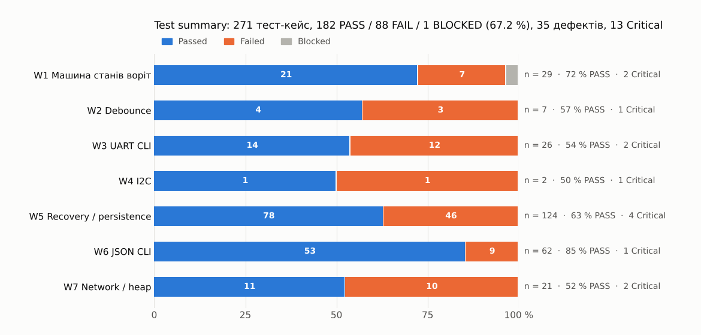
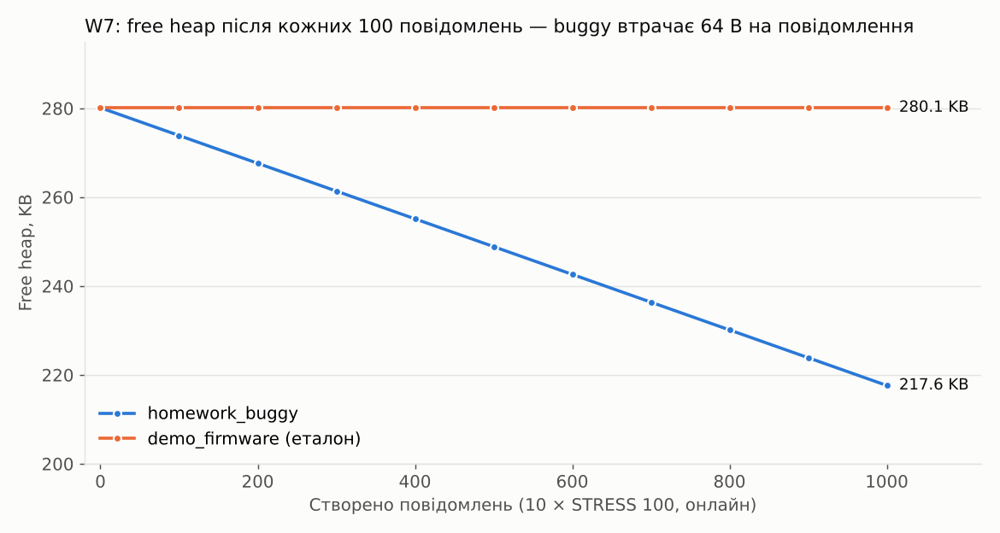

# Smart IoT Safety Controller: Embedded QA Case Study

Фінальний проєкт курсу Embedded QA (Prometheus EMB101, 2026) · Лахно Анатолій · 02.11.2026
**Висновок: NO-GO** для пілоту з реальним приводом — [Release Decision](docs/release-decision.md)

## Project goal

**Що тестуємо:** прошивку ESP32-контролера, який керує приводом воріт (два реле) і передає телеметрію через MQTT.
**Навіщо:** вирішити, чи можна ставити її на пілотний об'єкт. Головне питання — чи може реле опинитися під напругою без команди і чи дізнаємося ми про збій.
**Що зробив QA:** визначив і пріоритизував ризики, побудував стратегію й матрицю тестів, виконав 271 тест у 7 підсистемах, зібрав evidence package і дав обґрунтовану рекомендацію щодо релізу.

## System under test

| | |
|---|---|
| HW | ESP32 DevKit v1 (ESP32-WROOM-32); DevKit-C v4 для I2C; Arduino Uno — прототип логіки воріт |
| Сенсори / входи | DHT22, MPU6050 (I2C 0x68), кінцеві датчики, кнопки OPEN / CLOSE / STOP |
| Виконавчі елементи | OPEN / CLOSE relay, реле навантаження, LED, ERROR LED, buzzer |
| Інтерфейси | GPIO + переривання, UART 115200, I2C ≈100 kHz, Wi-Fi / MQTT |
| FW | 7 збірок-підсистем: машина станів воріт, debounce, UART CLI, I2C, recovery / NVS (sha256 `b4c58c49…`), JSON CLI, network node (`d953e339…`) — [версії](master-test-plan.md#12-версії-firmware-release-candidate) |
| Безпечний стан | Обидва реле OFF |

Схема й критичні стани — [docs/system-overview.md](docs/system-overview.md).

## Test strategy

Risk-based: **Ризик = Ймовірність × Вплив** → тестуємо спочатку і глибше там, де ризик вищий.

| Risk | Failure mode → Impact | Ризик | Результат |
|---|---|:-:|---|
| R01 | Реле не зупиняється на лімітері / по таймауту → привід тисне без обмеження | 🟥 9 | ❌ Critical, 5/5 |
| R02 | Реле вмикається після WDT / brown-out / RESET → несанкціонований рух | 🟥 9 | ❌ Critical, 10/10 |
| R03 | Перебій живлення під час збереження → хибний стан реле | 🟥 9 | ❌ Critical, 3/3 |
| R04 | Один NACK на I2C → тихе зависання | 🟥 9 | ❌ Critical, 2/2 |
| R06 | Офлайн-телеметрія губиться / дублюється, `dropped=0` | 🟥 9 | ❌ Critical, 3/3 |
| R11 | Витік heap → вичерпання за ≈12 год → reset | 🟥 9 | ❌ Critical, 3/3 |

+ 7 ризиків середнього й низького рівня — [docs/risk-matrix.md](docs/risk-matrix.md).

- [**Master Test Plan**](master-test-plan.md): System Overview, Scope / Out of Scope, Quality Risks, Test Levels & Types, Test Environment, Entry / Exit Criteria, Regression, Evidence & Reporting, Risks / Assumptions / Dependencies, ролі.
- [**Test Matrix**](docs/test-matrix.md): 40 рядків Risk → Level → Test → Environment → Expected → Evidence → Regression → Status.
- Рівні: component / interface, integration, system black-box, fault injection, non-functional / reliability, automation / regression.
- Критерій успіху (exit): 0 Blocker / Critical, recovery з реле OFF, regression 3/3, evidence для кожного FAIL, відомі ризики прийнято.

## Environment & tools

| Що потрібно було довести | Чим |
|---|---|
| Логіку станів, реле, таймаути | Wokwi simulation |
| Поведінку інтерфейсу, reset reason, протокол CLI | Serial / CLI з часовими мітками |
| Що відбувається на шині I2C і на піні GPIO | Logic analyzer + PulseView / sigrok (VCD) |
| Recovery у точну мілісекунду, повтори ×10 / ×20, ID-трасування | Python + pytest на host-моделі ESP32 (незмінений `sketch.ino`), ASan / UBSan |
| Reconnect, буфер, дублікати, heap | MQTT / network environment (емуляція `NET DOWN/UP`) |
| Електрику, реальний brown-out, радіо | Real hardware — **не було**, тому це residual risks і T-38…T-40 |

Кожен автоматизований набір має **контроль на еталонній прошивці** (121/124, 62/62, 21/21), тож FAIL не можна списати на harness.

## Key scenarios

1. **Лімітер в OPENING** — реле лишається ON, таймаут 10 с не спрацьовує (у CLOSING — рівно 10.0 с).
2. **hang → WDT → relay** — reset за 4008 мс (PASS), але через ≈340 мс реле знову ON, 10/10.
3. **Обрив між двома записами NVS** — після `relay off` пристрій стартує з relay ON.
4. **NACK на I2C** — еталон робить 3 retry і fallback; buggy зависає після першого NACK.
5. **12 повідомлень у буфер на 8** — `count=12/8`, `dropped=0`, ID 1–4 зникли, решта — двічі.
6. **10 × STRESS 100** — −64 B heap на повідомлення; еталон — 0 B.

## Bugs / findings

- **35 дефектів**: 13 Critical (8 — Blocker у ризиках безпеки) · 16 Major · 3 Medium · 3 Minor — [Defect Log](bug-reports/defect-log.md).
- **9 release-blocking bug reports** з Preconditions / Steps / Expected / Actual / Severity / Reproducibility / Evidence — [bug-reports/bug-reports.md](bug-reports/bug-reports.md).
- Патерн: happy path працює, ламається **межа** — часу, reset, запису, протоколу, ємності, довжини.
- Ланцюги: **I2C hang → WDT → реле ON** і **витік heap → reset → реле ON**.

## Evidence

| Що доводить | Доказ |
|---|---|
| Реле ON через ≈340 мс після WDT reset | [W5 лог WDT03](pytest/w5_recovery/evidence/logs/) · reset @4619.0 мс → `GPIO pin=5 level=1` @4967.9 мс |
| Тихе зависання після першого NACK | [PulseView-timeline](pulseview/i2c_mpu6050/fig4_buggy_hang_timeline.png) |
| `relay off` + обрив між записами NVS → старт з relay ON | [W5 лог DI04](pytest/w5_recovery/evidence/logs/) |
| −64 B heap на повідомлення; еталон — 0 B | [графік](network-stress/charts/heap_trend.png) · [Memory Stability Log](network-stress/memory-stability-log.md) · [CSV](network-stress/heap_trend.csv) |
| Reconnect storm: ≈370 спроб за 20 с проти 6 | [графік](network-stress/charts/reconnect_attempts.png) · [CSV](network-stress/network_stress.csv) |
| Шум 5 мс = натискання | [VCD / PNG / Serial](pulseview/gpio_debounce/) |





Повний індекс (44 позиції): [evidence-index.md](evidence-index.md) · підсумок виконання: [docs/test-summary.md](docs/test-summary.md).

## What I learned / decisions made

- **Рішення — за наслідком, а не за pass rate.** 67.2 % PASS, і все одно NO-GO: Critical-дефекти в усіх чотирьох ризиках безпеки реле. При 98 % рішення було б тим самим.
- **PASS теж потребує перевірки.** Перший прогін W7 показав рівний heap — хибний PASS: модель, зібрана з `-O1`, не бачила алокацію, бо її прибрав компілятор. Звірка з другим harness знайшла сліпу зону ([деталі](network-stress/memory-stability-log.md#як-цей-витік-спершу-пропустили)).
- **Out of scope — свідоме рішення, а не прогалина.** Того, що не доводять Wokwi й модель, симуляцією не «закрито»: це residual risks з конкретними тестами для заліза.
- **Наступні кроки:** Wokwi CI для гейта, інтеграційна збірка + T-40, плата для T-38 / T-39, CI з дим-тестом.

## Repository structure

```
README.md               ← ви тут
master-test-plan.md     ← Master Test Plan
case-study.md           ← фінальний репорт: problem → risk → design → execution → evidence → findings → conclusion
evidence-index.md       ← Evidence Package: claim → файл → рядок / значення
docs/                   ← system overview, risk matrix, test matrix, test summary, release decision, defense brief
wokwi/                  ← W1 Smart Gate (test sheet, test cases), Wokwi CI scenarios для debounce
pulseview/              ← logic-analyzer evidence: I2C traces (W4), VCD + PNG debounce (W2)
uart-cli/               ← W3 UART CLI: serial transcript, test report
pytest/                 ← автотести: W5 recovery (124), W7 network (21), результати W6 (62)
network-stress/         ← W7: логи 3 прогонів + еталон, CSV, графіки, Memory Stability Log
bug-reports/            ← 9 bug reports, defect log (35), bug log W1
resume/                 ← профіль: навички Embedded QA з посиланнями на докази
```

Прошивки курсу не публікуються (матеріали курсу). Щоб перезапустити тести, покладіть `sketch.ino` у `pytest/*/firmware/` — [pytest/README.md](pytest/README.md).
