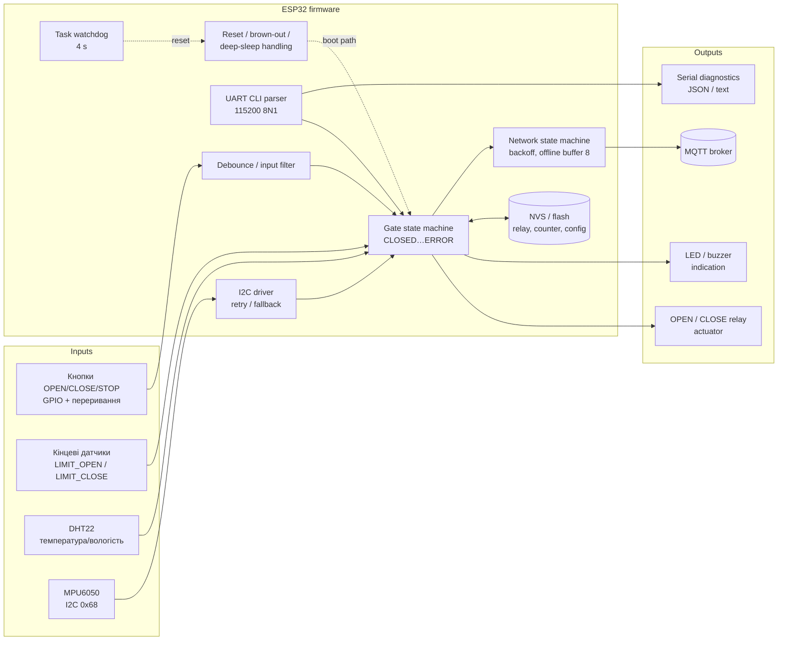

# System Overview: Smart IoT Safety Controller

## Що це за пристрій

**Smart IoT Safety Controller** — вузол на ESP32, який керує виконавчим механізмом (привід воріт / реле навантаження) і передає телеметрію в мережу.
Пристрій поєднує локальне керування (кнопки, кінцеві датчики, реле) з сервісним UART CLI, датчиками на I2C та одношинному інтерфейсі, енергонезалежною пам'яттю, watchdog і Wi-Fi/MQTT.

Головна вимога до продукту: **пристрій має поводитися передбачувано не лише в happy path, а й при шумі на входах, збоях протоколів, зависаннях, падінні живлення та втраті мережі**. Найнебезпечніший наслідок будь-якого збою — несанкціонований рух або увімкнене реле.

## Архітектура

## Основні inputs / outputs

| Inputs | Outputs |
|---|---|
| Кнопки OPEN / CLOSE / STOP (GPIO, переривання) | OPEN relay, CLOSE relay (привід) |
| Кінцеві датчики LIMIT_OPEN / LIMIT_CLOSE | Реле навантаження (GPIO5) |
| DHT22 — температура / вологість | LED OPEN / CLOSE / ERROR, buzzer |
| MPU6050 по I2C | Serial-діагностика (текст / JSON), reset reason |
| Команди UART CLI | Телеметрія MQTT з message ID, лічильники `sent / dropped / duplicates` |
| Стан мережі (втрата / відновлення) | Записи в NVS (`relay`, `counter`, конфігурація) |
| Живлення (перебої, просадки) | — |

## Критичні стани (для безпеки та працездатності)

| Стан | Чому критичний | Що має бути |
|---|---|---|
| OPENING / CLOSING | Реле під напругою, привід рухається | Зупинка на лімітері або по таймауту 10 с; OPEN і CLOSE ніколи не разом |
| ERROR | Пристрій виявив несправність | Реле OFF; вихід лише через RESET |
| Перші ≈500 мс після будь-якого reset (WDT, brown-out, power on) | Boot path ініціалізує виходи й читає збережений стан | Реле OFF до явної команди; правильний reset reason |
| Запис у NVS | Перебій живлення посередині | Старий або новий цілісний стан, не змішаний |
| Збій периферії (I2C NACK) | Main loop може заблокуватися | Retry → ERROR + FALLBACK, main loop живий |
| Офлайн із заповненим буфером | Тиск на пам'ять і дані | Ємність 8, DROP_OLDEST, втрату видно в `dropped` |

## Зовнішні залежності

Живлення (блок живлення, просадки), мережа й MQTT-брокер (хмарні сервіси), фізичні датчики й механіка приводу. Від них залежить робота системи, і саме їх найважче змоделювати, тому вони в residual risks Master Test Plan.

## Компоненти та де вони тестувалися

Інтегрованої прошивки «одним файлом» у курсі немає. Кожну підсистему перевіряли на окремій навчальній збірці з навмисними дефектами (`*_buggy`), а там, де була еталонна збірка (`demo`), вона слугувала контрольним прогоном для harness.

| Підсистема | Навчальна збірка | Платформа | Практика |
|---|---|---|---|
| Actuator state machine (ворота, реле, кінцеві датчики, таймаут) | Smart_Gate_Controller_Buggy_QA_Training_1 | Arduino Uno, Wokwi | W1 |
| Цифровий вхід, переривання, debounce | Debounce_Homework_VSCode_LogicAnalyzer_Logger | ESP32 DevKit v1 | W2 |
| Сервісний UART CLI | UART CLI HOMEWORK DEVICE v2.0 | ESP32 DevKit v1 | W3 |
| Периферія на I2C (MPU6050), retry/fallback | Wokwi I2C NORMAL / BUGGY v2 | ESP32 DevKit-C v4, Wokwi + logic analyzer | W4 |
| Reset/recovery: WDT, brown-out, deep sleep, NVS | embedded_qa_wokwi_lab homework_buggy (sha256 `b4c58c49…`) | ESP32, host-модель | W5 |
| JSON CLI + DHT22 + relay/PWM | ESP32 Serial JSON CLI homework_buggy | ESP32, host-модель | W6 |
| Wi-Fi/MQTT: reconnect, offline buffer, duplicates, heap | webinar_7 homework_buggy (sha256 `d953e339…`) | ESP32, host-модель | W7 |

## Interfaces та dependencies

| Interface | Параметри | Залежність / що може зламатися |
|---|---|---|
| GPIO input + interrupt | GPIO18, INPUT_PULLUP, CHANGE | брязкіт контактів, EMI-шум |
| GPIO output | relay (GPIO5 / піни Uno), LED GPIO2 | стан після reset, одночасне увімкнення двох реле |
| UART0 | 115200 8N1, LF/CR/CRLF, RX FIFO 256 B | довжина рядка, сміття, пакетний ввід |
| I2C | ≈100 kHz, SDA GPIO21 / SCL GPIO22, адреса 0x68 | NACK, відсутній пристрій, зависання master |
| 1-wire DHT22 | GPIO15 | timeout / checksum, значення поза діапазоном |
| NVS (flash) | ключі `relay`, `counter`, конфігурація | обрив живлення між записами, bit-flip |
| Wi-Fi / MQTT | QoS-подібний протокол з message ID | втрата брокера, флапи, переповнення буфера |

## Critical data та critical actuators

- **Actuators:** OPEN relay і CLOSE relay (рух воріт), загальне реле навантаження. Безпечний стан — **обидва OFF**.
- **Critical state:** стан машини станів, `relay` і `counter` у NVS, конфігурація CLI (speed/timeout).
- **Critical telemetry:** message ID і порядок повідомлень, лічильники `sent / dropped / duplicates`.
- **Diagnostics:** reset reason, ERROR LED і buzzer, серійні повідомлення. Без них оператор не відрізнить збій від норми.

## Що тут може реально нашкодити

1. Реле лишається увімкненим за кінцевим положенням або після збою: механічне пошкодження, ризик для людини.
2. Реле само вмикається після reset (WDT, brown-out, обрив живлення): несанкціонований рух.
3. Один дотик або імпульс шуму дає кілька команд: несподіваний рух.
4. Прошивка тихо зависає на периферії й перестає реагувати на STOP і датчики.
5. Телеметрія губиться або дублюється без сліду: рішення приймаються на хибних даних.

Звідси і починаються ризики в [Risk Matrix](risk-matrix.md).
