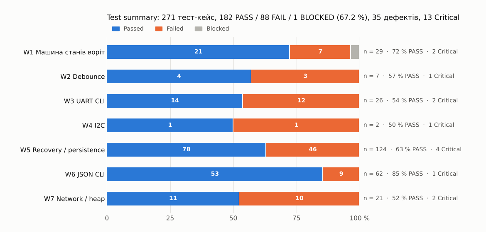

# Test Summary

Цикл: 7 практик (W1–W7), 28.10–02.11.2026. Підсумковий звіт виконання за всіма підсистемами release candidate.

## Загальний результат

| Total tests | Passed | Failed | Blocked | Pass rate | Defects | Overall |
|---:|---:|---:|---:|---:|---:|:-:|
| **271** | **182** | **88** | **1** | **67.2 %** | **35** (13 Critical) | ❌ **FAIL → NO-GO** |

## За підсистемами

| Практика | Підсистема | Середовище | Total | Passed | Failed | Blocked | Pass rate | Прогони | Defects | Звіт |
|---|---|---|---:|---:|---:|---:|---:|---|---:|---|
| W1 | Машина станів воріт | Wokwi | 29 | 21 | 7 | 1 | 72.4 % | 5/5 на FAIL | 7 | [wokwi/smart_gate](../wokwi/smart_gate/) |
| W2 | Debounce | Host + VCD | 7 | 4 | 3 | 0 | 57.1 % | 5 на кейс | 3 | [pulseview/gpio_debounce](../pulseview/gpio_debounce/) |
| W3 | UART CLI | Host | 26 | 14 | 12 | 0 | 53.8 % | 5 на кейс + 105 ASan | 8 | [uart-cli](../uart-cli/) |
| W4 | I2C | Wokwi + LA | 2 | 1 | 1 | 0 | 50.0 % | BUGGY 2/2 | 1 | [pulseview/i2c_mpu6050](../pulseview/i2c_mpu6050/) |
| W5 | Recovery / persistence | Host + pytest | 124 | 78 | 46 | 0 | 62.9 % | 3 + demo | 9 | [pytest/w5_recovery](../pytest/w5_recovery/evidence/summary.md) |
| W6 | JSON CLI | Host + pytest | 62 | 53 | 9 | 0 | 85.5 % | 3 + demo | 3 | [pytest/w6_json_cli](../pytest/w6_json_cli/) |
| W7 | Network / buffer / heap | Host + pytest | 21 | 11 | 10 | 0 | 52.4 % | 3 + demo | 4 | [network-stress](../network-stress/summary.md) |

## Контрольні прогони на еталонних прошивках

| Набір | Еталон | Результат | Що це доводить |
|---|---|---|---|
| W5 | embedded_qa_wokwi_lab demo | 121 / 124 PASS (3 FAIL — та сама прогалина вимог в еталоні) | Harness не дає хибних FAIL |
| W6 | webinar_6 demo | 62 / 62 PASS | Те саме |
| W7 | webinar_7 demo_firmware | 21 / 21 PASS | Те саме, включно з heap trend на `-O0` |
| W4 | Wokwi I2C NORMAL_v2 | PASS: retry ≈250 мс ×3 → ERROR + FALLBACK → recovery | Еталонна поведінка, з якою порівнюється BUGGY |

## Дефекти за severity

| Blocker* | Critical | Major | Medium | Minor | Разом |
|---:|---:|---:|---:|---:|---:|
| 8 | 5 | 16 | 3 | 3 | **35** |

\* Blocker — Critical-дефект у ризиках безпеки актуатора R01–R04 без обхідного шляху (усього Critical — 13).

## Чому pass rate не визначає рішення

67.2 % PASS не означає «на дві третини готово». Рішення визначають 13 Critical-дефектів у фейлах: 8 із них — у ризиках безпеки актуатора. Якби пройшли 98 % тестів, а лишився один дефект «реле вмикається після WDT reset», рішення було б тим самим. Див. [Release Decision](release-decision.md).
