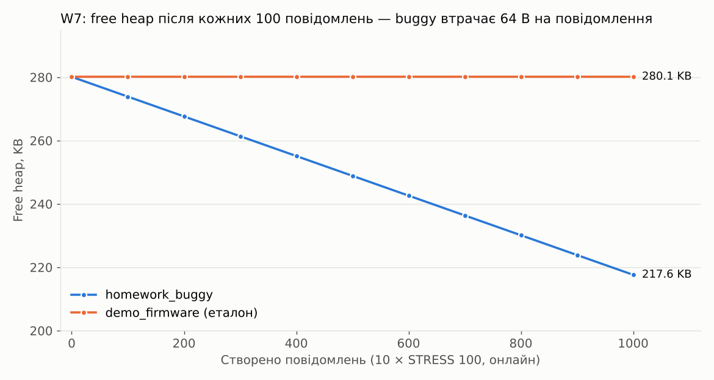
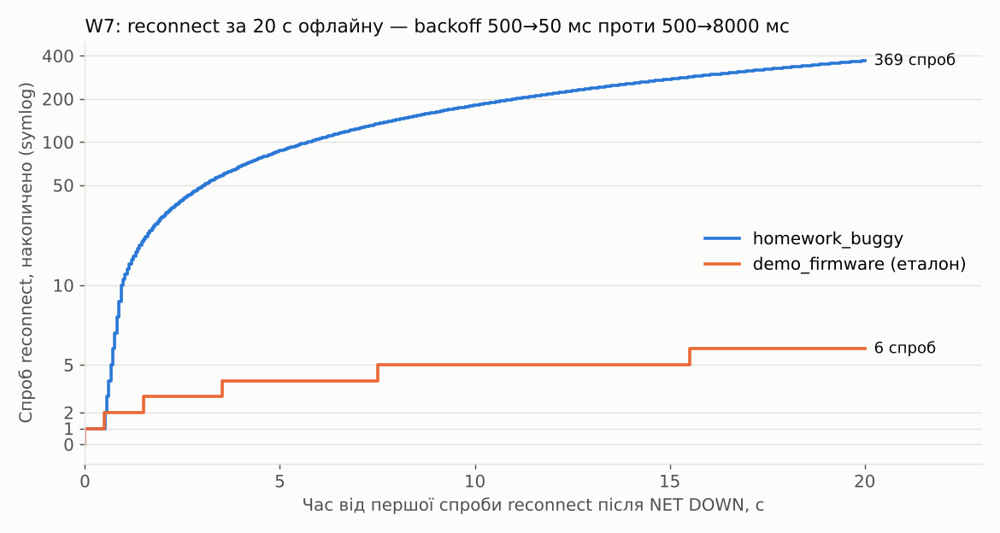

# network-stress/

W7 IoT network node: втрата мережі, reconnect, офлайн-буфер, дублікати, стабільність пам'яті (ризики R06, R09, R11).
Прошивка `homework_buggy` (sha256 `d953e339…`), контроль — `demo_firmware` (`60ee7607…`). Набір тестів — [../pytest/w7_network/](../pytest/w7_network/).

## Головне

| Що | Buggy | Еталон | Вимога |
|---|---|---|---|
| Спроб reconnect за 20 с офлайну | ≈370 (backoff 500 → 50 мс) | 6 (500 → 1000 → 2000 → 4000 → 8000) | R2: backoff, без storm |
| 12 повідомлень у буфер на 8 | `count=12/8`, `dropped=0`, ID 1–4 втрачено, решта — двічі | `count=8`, `dropped=4`, опубліковано 5…12 по разу | R4: DROP_OLDEST, втрату видно |
| Повідомлення після reconnect | кожен ID двічі | кожен ID раз | R6: без дублікатів |
| Heap на 1000 повідомлень | −64 000 B (−64 B / повідомлення) | 0 B | R7: без систематичного падіння |

## Файли

| Файл | Що в ньому |
|---|---|
| [memory-stability-log.md](memory-stability-log.md) | Memory Stability Log за шаблоном курсу: ітерації, стан мережі, буфер, sent / dropped / duplicates, free heap; висновок і прогноз |
| [heap_trend.csv](heap_trend.csv) | Дані для графіка heap: buggy і еталон, онлайн і офлайн |
| [network_stress.csv](network_stress.csv) | Кожна спроба reconnect: номер, час від першої спроби, backoff |
| [message_ids.csv](message_ids.csv) | ID у черзі, ID опубліковані по порядку, втрачені ID — для кожного сценарію буфера |
| [summary.md](summary.md) | Результати pytest: buggy ×3 (11 PASS / 10 FAIL, усі FAIL 3/3), еталон 21/21, виміряні значення |
| `buggy/run1/logs/`, `demo/run1/logs/` | Повний лог кожного тесту: TX / RX / GPIO з часом пристрою |
| `buggy/run{1,2,3}/junit.xml`, `demo/run1/junit.xml` | JUnit XML |
| [asan_overflow_scenario_C.txt](asan_overflow_scenario_C.txt) | Сценарій переповнення буфера під ASan / UBSan: помилок пам'яті немає, отже втрата даних — логіка прошивки |

Дефекти: W7 BUG-01…04 → [MTP-BUG-05, 06, 07, 09](../bug-reports/bug-reports.md).
